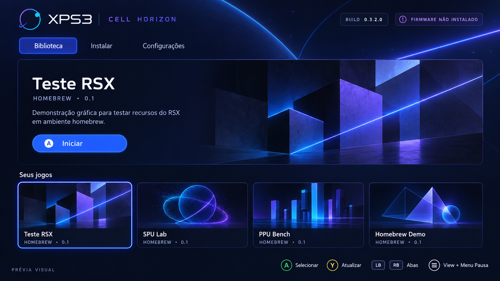
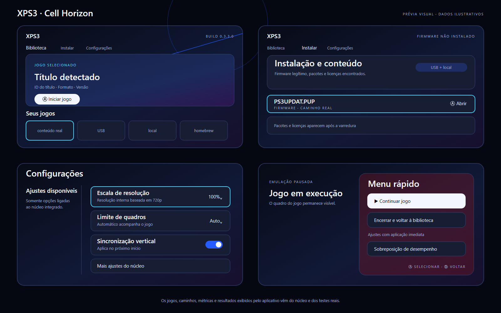

XPS3 — PlayStation 3 experimental emulator for Xbox
====================================================

XPS3 is an experimental RPCS3-derived UWP port for Xbox Series X|S in Developer Mode. The project
keeps the RPCS3/RPCS3-Xbox history and adds its own package identity, television interface, build
pipeline and evidence boundary. Firmware, games and copyrighted cover art are not distributed.

## Download

Installable versions are published on the [Releases page](https://github.com/LeonardoFigueiredo24/XPS3/releases).
Each release contains the XPS3 APPX, Microsoft.UI.Xaml dependency, development certificate,
checksums, installation instructions and matching source code. See [docs/RELEASES.md](docs/RELEASES.md)
for the publication process.

> XPS3 is under active development. A successful build proves that the package was compiled and
> validated; it does not prove that a specific PS3 game works on Xbox. Compatibility is recorded
> only from an identifiable XPS3 build tested on the target console.

## Cell Horizon interface

The interface has three controller-friendly tabs: **Biblioteca**, **Adicionar e instalar** and **Configurações**,
plus a lateral in-game quick menu. The library displays only content found by the emulator, and the
settings page displays only controls connected to the integrated core. The images above are visual
previews, not Xbox captures or compatibility evidence. See [docs/UX_DIRECTION.md](docs/UX_DIRECTION.md).

## Current XPS3 status

| Area | Status |
| --- | --- |
| Xbox UWP probe | JIT, D3D12, controller and 5 GiB Game allocation tested on the user's Series S |
| RPCS3/RPCS3-Xbox core | Integrated; ongoing adaptation and validation |
| Cell Horizon frontend | 0.3.3.0 launched on Xbox and executed the basic RSX triangle ELF; 0.3.5.0 storage/preparation source pending package and Xbox validation |
| Installable package | Published only after the tagged workflow compiles, signs and validates it |
| Commercial games | No title is classified as working in XPS3 without versioned Xbox evidence |

Detailed evidence is maintained in [docs/PROJECT_STATUS.md](docs/PROJECT_STATUS.md). The next hardware
test sequence is in [docs/XBOX_TEST_PLAN.md](docs/XBOX_TEST_PLAN.md).

## Install on Xbox Developer Mode

1. Download the APPX and `Microsoft.UI.Xaml.2.8.appx` from the same XPS3 release.
2. In Xbox Device Portal, select the XPS3 APPX and add Microsoft.UI.Xaml as a dependency.
3. In Dev Home, open the XPS3 details and set **App type: Game** to use the Game memory budget.
4. Start XPS3 and follow the version-specific test plan. Supply only legally obtained firmware and games.

See the release's `INSTALL.md` for complete instructions.

## Source, credits and evidence

See [XPS3_INTEGRATION.md](XPS3_INTEGRATION.md) for provenance, privacy changes and the integration
boundary. The complete project remains GPL-2.0-compatible and preserves upstream credits.

RPCS3 for Xbox (UWP) — imported upstream reference
====================================================

> The section below is preserved from the imported base for engineering reference. Its game results,
> branding, telemetry service and release instructions describe that upstream project. They are not
> automatically XPS3 results or XPS3 services. Use the XPS3 sections above for downloads and status.

> **Proof of concept.** This is an unofficial, experimental port of the [RPCS3](https://rpcs3.net)
> PlayStation 3 emulator to Xbox Series X|S as a UWP app (Developer Mode). It is **not** supported by
> the RPCS3 team, so please don't ask them for help with it. Expect crashes, slow games and rough edges.
>
> The port is about 99% vibecoded: written with AI assistance (Claude), steered and checked with my
> previous programming knowledge. :)

**Video of it running on YouTube** (click the picture):

Downloads are on the [Releases](../../releases) page. Building, packaging, internals, all settings and
known issues are in [uwp/README.md](uwp/README.md).

## What works (October 2026)

Based on the developer's own tests and the opt-in telemetry from players' consoles (October 24–25).
Speeds are averages on Series X and S; the first start of a game is always slower (see below).

| Game | State |
| --- | --- |
| PS3 system menu (XMB, firmware 4.93) | Steady 60 fps, network and web browser work |
| Portal 2 | Playable, ~28 fps (limited by the emulated PPU main thread); short stutters |
| Minecraft PlayStation 3 Edition | Playable, 50–57 fps with small stutters (pick "Continue playing offline" at the PSN prompt) |
| Jetpack Joyride Deluxe | Playable, 60 fps |
| GTA V | In-game, ~25 fps (limited by the emulated SPUs) |
| X-Men Origins: Wolverine | In-game, 22–24 fps; can crash after about 30 minutes when memory runs out |
| PlayStation Home | Works, ~20 fps; sometimes crashes in the main plaza or right after the RPCN sign-in |
| 50 Cent: Blood on the Sand, SAW II | In-game, but can crash mid-game (the GPU device is lost) |
| LittleBigPlanet | Boots; slow on the first start, crashes after a few minutes in game |
| Mortal Kombat vs. DC Universe | Crashes about 10 minutes in, every time |
| 007 Legends | Boots, intro scene around 40 to 55 fps |
| Watch Dogs, Plants vs. Zombies Garden Warfare | Boot, but not playable (single-digit fps or crashes) |

Tried a game that isn't listed? Compatibility reports are welcome (see [Contributing](#contributing)).

Heavy games are mostly CPU-bound: the Xbox runs the PPU/SPU recompilers fine, but big games need
more CPU and memory than a UWP game app gets (5 GB). The first start of the XMB or a game compiles
its code and shaders and can take several minutes; later starts use the cache.

## Installing on your Xbox

You need an Xbox Series X|S in **Developer Mode**, a PC on the same network, a **USB drive or
external hard drive** (the emulated PS3 hard drive, games and caches live there; the app's own
storage is far too small), and your own PS3 firmware file (`PS3UPDAT.PUP`, 4.93 is tested) and games.

1. Put the console in Developer Mode (Microsoft's "Xbox Dev Mode" app and a developer account) and
   enable the Device Portal in Dev Home. Open it in a browser on your PC: `https://<your-xbox-ip>:11443/`.
2. From the release, download the `.appx` and `Microsoft.UI.Xaml.2.8.appx`.
3. In Device Portal: **Home > Add**, choose the RPCS3 `.appx`, then on the next page add
   `Microsoft.UI.Xaml.2.8.appx` as a dependency, and install.
4. In Dev Home on the Xbox, highlight **RPCS3 Xbox (Beta)**, press View > **View details** and set
   **App type: Game** (gives the app 5 GB of RAM instead of 1 GB). Reinstalling can reset this.
5. Plug in the USB drive and start the app. Copy `PS3UPDAT.PUP` to the root of the USB drive (or
   `PS3/UPDATE/`), open the **Install** tab and install the firmware.
6. Put games on the USB drive: game folders (with `PS3_GAME` inside) or `.iso` files in `GAMES/`,
   `PS3ISO/` or the root, and `.pkg`/`.rap` files in `PKG/` or the root (install those from the
   Install tab). Press Y in the menu to look again. Boot the XMB or a game from the **Games** tab.

### Controls

| Xbox | PS3 |
| --- | --- |
| A / B / X / Y | Cross / Circle / Square / Triangle |
| Menu / View | Start / Select |
| Tap View + Menu | PS button |
| Hold View + Menu ~1 s | Pause menu (resume, stop the game, live settings) |

In the app menu: D-pad or left stick to move, A select, B back, LB/RB switch tabs, Y rescan.

## Privacy and log sending (telemetry)

On the first start the app asks whether it may send its logs to me, the developer, to help fix the
emulator. Nothing is sent unless you choose **Yes**, and you can turn it off at any time in
**Settings > Send logs to the developer**.

When it is on, the app sends reports to `rpcs3.emelinhabibovic.de`, automatically:

- when you agree (an "install" report, so I can count consoles) and when the app starts,
- when a game, homebrew or the XMB starts and when it stops (with the emulator log),
- after an emulator crash or fatal error, and on the next start after a run that ended while a game
  was running (with that run's logs).

**What is sent:** the emulator log (RPCS3.log, plus Mesa's graphics log and the app's memory log
after a crash), the app version and build commit, the console model (e.g. Xbox Series S), the Xbox
OS version, the PS3 firmware version, the emulator settings, the title ID and name of the game that
ran, how long it ran, and an **anonymous ID**: a random number made on your console when the app
first starts. It is shown at the top right of the menu, above the firmware, so you can mention it
in a bug report. Reports are grouped by that ID only.

**What is not sent:** your Xbox gamertag or Microsoft account, your RPCN username, password, token
or email, other players' names, IP or MAC addresses, your location, or the list of games you have.
The app removes these from the logs before uploading (`uwp/app/uwp_telemetry_scrub.cpp`), and the
server filters them again. The server doesn't store IP addresses. Reinstalling the app makes a new
anonymous ID and asks again. To have your reports deleted, open an issue or contact me with your
anonymous ID.

## Contributing

Pull requests are very welcome, and so are compatibility reports: if you try a game, open an issue
with the game's name and title ID, what happened (fps, crashes, glitches) and the app version.

## License and credits

This port is based on [RPCS3](https://github.com/RPCS3/rpcs3) and keeps its license (GPL-2.0, see
[LICENSE](LICENSE)); all emulation credit goes to the RPCS3 team and contributors. Graphics run on
[Mesa](https://mesa3d.org)'s Dozen driver (Vulkan on D3D12, MIT license) with Microsoft's DXIL
signer. The menu uses Microsoft's WinUI 2 (MIT). The source of everything in a release is in this
repository.

The upstream RPCS3 README follows.

---

RPCS3
=====

The world's first free and open-source PlayStation 3 emulator/debugger, written in C++ for Windows, Linux, macOS and FreeBSD.

You can find some basic information on our [**website**](https://rpcs3.net/). Game info is being populated on the [**Wiki**](https://wiki.rpcs3.net/).
For discussion about this emulator, PS3 emulation, and game compatibility reports, please visit our [**forums**](https://forums.rpcs3.net) and our [**Discord server**](https://discord.gg/RPCS3).

[**Support the Lead Developers on Patreon**](https://rpcs3.net/patreon)

## Contributing

If you want to help the project but do not code, the best way to help out is to test games and make bug reports. See:
* [Quickstart](https://rpcs3.net/quickstart)

If you want to contribute as a developer, please take a look at the following pages:

* [Coding Style](https://github.com/RPCS3/rpcs3/wiki/Coding-Style)
* [Developer Information](https://github.com/RPCS3/rpcs3/wiki/Developer-Information)

**Before opening a pull request, please read our [contribution guidelines](.github/CONTRIBUTING.md).** In short:

* Discuss new ideas with the developers first, either in the **#development** channel on [Discord](https://discord.gg/RPCS3) or by opening a GitHub issue.
* Pull requests from first-time contributors must link an issue that a maintainer has assigned to them (`Fixes #<issue number>` in the description). Pull requests without one are closed automatically.
* Test your changes before submitting them. AI-assisted contributions must be disclosed, and you must fully understand and own any code you submit. See the [AI use policy](.github/CONTRIBUTING.md#ai-use).

## Building

See [BUILDING.md](BUILDING.md) for more information about how to setup an environment to build RPCS3.

## Running

Check our friendly [quickstart](https://rpcs3.net/quickstart) guide to make sure your computer meets the minimum system requirements to run RPCS3.

Don't forget to have your graphics driver up to date and to install the [Visual C++ Redistributable Packages for Visual Studio 2022](https://aka.ms/vs/17/release/VC_redist.x64.exe) if you are a Windows user.

## License

Most files are licensed under the terms of GNU GPL-2.0-only License; see LICENSE file for details. Some files may be licensed differently; check appropriate file headers for details.
